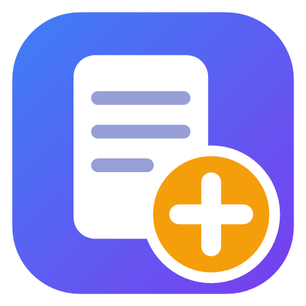

<p align="center"></p>

# BlocPlus

> **Coming soon to the [Microsoft Store](https://apps.microsoft.com/detail/9PBMQDG1JZV9).** Until then, download it from the [latest release](https://github.com/u0f/BlocPlus/releases/latest).

A lightweight text editor for Windows that replaces Notepad. It is a single C# file with no dependencies, and it compiles with the compiler that already ships with Windows. You don't need Visual Studio, the .NET SDK or any extra download.

## Features

- **Tabs**: a **+** button, close buttons, drag to reorder, middle-click to close, Ctrl+Tab to switch tabs and Ctrl+Shift+T to reopen the last closed tab.
- **Sessions like modern Notepad**: closing the editor doesn't ask you to save. Open tabs and unsaved text come back the next time you start it, and a copy is saved every 30 seconds in case of a crash. You can turn this off in Settings.
- **Syntax highlighting** chosen from the file extension. Supported languages: C#, C/C++, Java/Kotlin/Swift, JavaScript/TypeScript, Python, Go, Rust, PHP, Ruby, PowerShell, Bash, Batch, SQL, Lua, HTML/XML, CSS, JSON, YAML, INI/TOML, Markdown, Dockerfile and Diff.
- **Light, dark or system theme.** The system theme follows the Windows setting as it changes.
- **Interface in 33 languages.** It follows the Windows display language, or pick one in Settings.
- **Line numbers**, word wrap, zoom and font selection.
- **Unlimited undo and redo.**
- **Find and replace** with case matching, whole words and regular expressions.
- **Multiple cursors**, like VS Code: Ctrl+click adds a cursor and Ctrl+drag adds a selection; typing, deleting, moving, copy and paste act on all of them. Escape goes back to one cursor.
- **Line editing**: duplicate, delete, move up or down, sort, trim trailing whitespace, change case, and indent or outdent a whole block with Tab and Shift+Tab.
- **Encodings**: detects and keeps UTF-8 (with or without BOM), UTF-16 LE/BE and ANSI, and keeps the original line endings (CRLF, LF or CR). You can convert both from the *Document* menu.
- **Safe saving**: the editor writes to a temporary file first, so a failed save never corrupts the original.
- **Detects external changes**: if another program changes an open file, the editor reloads it when you switch back to the window.
- **Live preview** for HTML, Markdown, reStructuredText, SVG and CSV/TSV: the editor on the left and the rendered result on the right, updated as you type and scrolled along with the editor (**View > Preview**, Ctrl+Shift+V).
- **LRC lyrics player**: the preview of an `.lrc` file plays its song or video (MP3, M4A/AAC or H.264 MP4) and highlights the line being sung; videos show the lyrics as subtitles. A file with the same name next to the `.lrc` loads automatically.
- **Installer and automatic updates**: see below.

## Installation

Download **`BlocPlus-Setup.exe`** from the [latest release](https://github.com/u0f/BlocPlus/releases/latest) and run it. Requirements: Windows 10 or 11.

- It installs for your user only, in `%LOCALAPPDATA%\Programs\BlocPlus`, so it doesn't need administrator rights.
- It adds BlocPlus to the Start menu, to the **Open with** list and to the right-click menu (**Editar con BlocPlus**).
- **To make it your default editor**, accept the offer at the end of the installation, or later choose **Help > Use as default editor**. Windows doesn't allow programs to set themselves as the default, so this opens *Settings > Default apps*, where you pick BlocPlus.
- **Updates**: every time it starts, BlocPlus checks GitHub for a new release. When there is one, a notice appears in the status bar. You can also check by hand with **Help > Check for updates**. Updating downloads the new version and restarts the editor, keeping your tabs. You can turn off the automatic check in Settings.
- **To uninstall**, use *Settings > Apps > Installed apps > BlocPlus*. The uninstaller asks whether to also delete your data in `%APPDATA%\BlocPlus` (settings, recent files and the saved session) or keep it for a future install.

If you'd rather not install anything, download **`BlocPlus.exe`** and run it from anywhere. That is the portable version.

## Building

Requirements: Windows 10 or 11. The .NET Framework 4.x that comes with Windows is enough.

```bat
build.cmd
```

This creates `dist\BlocPlus.exe` and `dist\BlocPlus-Setup.exe`. Both are the same program: when the file is named `BlocPlus-Setup*.exe`, it installs itself.

To publish a version: bump `AssemblyVersion` in `BlocPlus.cs`, add the entry to `CHANGELOG.md`, build, and create a GitHub release tagged `vX.Y.Z` with both files attached. The updater looks for the `BlocPlus.exe` asset in the latest release.

## Keyboard shortcuts

| Action | Shortcut |
|---|---|
| New tab / Open / Save / Save as | Ctrl+T (or Ctrl+N) / Ctrl+O / Ctrl+S / Ctrl+Shift+S |
| Save all / Close tab | Ctrl+Alt+S / Ctrl+W |
| Reopen closed tab | Ctrl+Shift+T |
| Switch tab | Ctrl+Tab / Ctrl+Shift+Tab |
| Find / Replace / Go to line | Ctrl+F / Ctrl+H / Ctrl+G |
| Find next / previous | F3 / Shift+F3 |
| Duplicate / Delete line | Ctrl+D / Ctrl+Shift+K |
| Move line | Alt+↑ / Alt+↓ |
| Upper case / lower case | Ctrl+Shift+U / Ctrl+U |
| Indent / Outdent block | Tab / Shift+Tab |
| Word wrap | Alt+Z |
| Live preview | Ctrl+Shift+V |
| Zoom | Ctrl++ / Ctrl+- / Ctrl+0 / Ctrl+mouse wheel |
| Insert date and time | F5 |
| Settings | Ctrl+, |

## Where data is stored

Settings, recent files and the session (including unsaved text) are stored in `%APPDATA%\BlocPlus`.

## Limitations

- Very large files (tens of MB) take a while to open. Syntax highlighting turns off above 3 MB.
- Printing is not supported.

## Contributing

BlocPlus is free and open source, and contributions are welcome: bug fixes, new features, more languages for syntax highlighting, translations or improvements to this documentation.

1. Fork the repository and create a branch for your change.
2. Make the change in `BlocPlus.cs` and check that `build.cmd` still compiles without errors or warnings.
3. Test it by hand in both the light and dark themes.
4. Add a line describing the change to [CHANGELOG.md](CHANGELOG.md).
5. Open a pull request explaining what it changes and why. Include a screenshot if it touches the interface.

Guidelines:

- Keep it to a single file with no external dependencies. The project should keep building with the `csc.exe` that ships with Windows.
- Follow the style of the existing code and keep changes small and focused. If you want to make a big change, open an issue first so we can discuss it.
- If you find a bug but don't want to fix it yourself, open an issue with the steps to reproduce it.

By submitting a pull request you agree that your contribution is licensed under the same GPL-3.0 license as the project.

## Changes

See [CHANGELOG.md](CHANGELOG.md).

## License

BlocPlus is free software released under the [GNU General Public License v3.0](LICENSE). You may use, study, modify and share it. If you distribute it, or any modified version, you must do so under the same license and include the source code.
